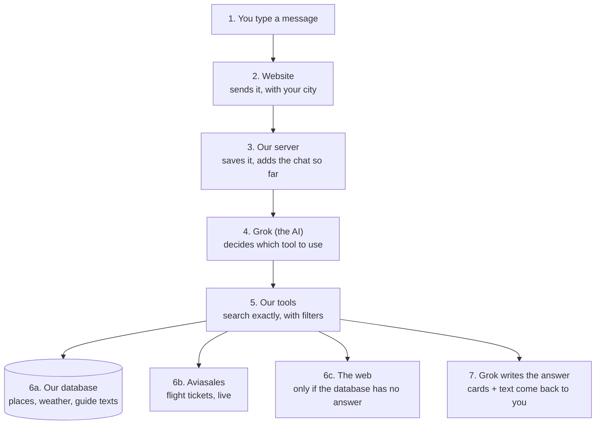

# How 1surak works

> [!tip] Real talk
> You don't need the tool names. Remember three things:
> 1. **Grok decides, our code calculates.** Grok (the AI) picks what to do. Every number comes from our code or our data, never from Grok's head.
> 2. **Most data is ready in advance.** Places, weather and guide texts were downloaded once and sit in our database.
> 3. **Only two things are fetched live:** flight tickets (Aviasales) and the web (only when our database has no answer).

## The picture

You write a message. It goes down through these layers, then the answer comes back up.

## The layers

| # | Layer | What it does | Where its data comes from |
|---|---|---|---|
| 1 | **You** | Type a message | Your words + the city in the picker |
| 2 | **Website** | Sends the message, shows the answer as it arrives | Nothing, it only carries |
| 3 | **Our server** | Saves your message, adds the earlier messages and our rules | Our database (the chat so far) |
| 4 | **Grok** | Reads everything and picks a tool, like a person choosing which app to open | Only what layer 3 gave it |
| 5 | **Our tools** | Do the real work: filter places, check weather, find tickets | Layer 6 |
| 6 | **Data** | The facts | 6a our database, 6b Aviasales, 6c the web |
| 7 | **Answer** | Grok writes the text, the website draws the cards | The tools' results |

## One real message, layer by layer

Example message, typed by a user in Moscow: **«хочу к тёплому морю в ноябре, недорого, с ребёнком 5 лет»**

| Step | What happens | Where from |
|---|---|---|
| 1 | The website sends the message + «Москва» (code MOW) | You, the picker |
| 2 | The server saves it. This is the first message, so there is no earlier chat | Our database |
| 3 | Grok writes down the trip: sea, November, 1 child aged 5, low budget | Your words |
| 4 | Grok asks the search tool: sea at least 24 °C in November, good with kids, cheap | Grok's choice |
| 5 | The tool checks all 53 of our places. Hurghada: sea in November about 26 °C | Our database (weather from Open-Meteo, saved in advance) |
| 6 | The tool reads visa, price level and «good with kids» for each place | Our database (our team's own table) |
| 7 | The tool asks for tickets Moscow → Hurghada: price, airline, hours, direct or not | Aviasales, live |
| 8 | Result: Hurghada and Sharm fit. Alanya just missed: sea about 23.7 °C | Our code compared the numbers |
| 9 | Grok tells the cards tool what to show, and writes the text | The results of steps 5 to 8 |
| 10 | You see the cards and the text, word by word. The server saves the reply | Back up through layers 3 and 2 |

**Answer:** the user sees Hurghada and Sharm as cards, each with real weather, a real ticket, and one line on why it fits.

## A detail question goes a different way

Example: **«где в Хургаде поплавать с маской?»** This isn't a search over places. It's a question about one place.

| Step | What happens | Where from |
|---|---|---|
| 1 | Grok calls the research tool | Grok's choice |
| 2 | The tool looks in our saved guide texts, by words and by meaning | Our database (Wikivoyage, saved in advance) |
| 3 | Found a passage about the «Синдбад» submarine trip along the reef → answer with its link | Our database |
| 4 | If nothing fits: search the web, save what it finds, answer from that | The web (Brave or Tavily) |

«By meaning» means it finds «для семей с детьми» even when you wrote «с ребёнком». No shared words needed.

## Old trips and other currencies

- **Each chat is a trip.** The sidebar says «Мои поездки». Under each trip: when it is and where it flies from, for example «Ноябрь · 7 ночей · из Астаны».
- **Tickets go stale in a day.** After 24 hours the trip shows «Цены от 23 окт могли измениться» and a button «Обновить цены».
- **«Обновить цены» does not ask Grok.** Our code takes the same cards, asks Aviasales again, and writes under each price how it moved: «дороже на 326 ₽ с 23 окт». That is instant and free.
- **Money is in the user's currency.** The departure city decides it: Астана gives tenge, Минск gives Belarusian roubles, Moscow gives roubles. Inside we keep roubles and convert only for the screen, at the Central Bank rate of 24 October 2026.

| From | Currency | 7 707 ₽ ticket shows as |
|---|---|---|
| Москва | ₽ | 7 707 ₽ |
| Астана | ₸ | 42 865 ₸ |
| Минск | Br | 282 Br |
| Anywhere else | $ | 96 $ |

## The catch

- **«Live» tickets are cached prices.** They're the cheapest tickets Aviasales users found in recent days, so the price can change.
- **Without the Aviasales token** (`TRAVELPAYOUTS_TOKEN` in `.env`) step 7 finds nothing, so every place shows «не нашлось билетов».
- **A city typed in the chat doesn't change the tickets yet.** «летим из Казани» doesn't switch them; only the picker does.

> [!note]- More detail: every data source (click to open)
> | Data | Source | Real or estimate? |
> |---|---|---|
> | Weather per month (air, rain) | Open-Meteo, averages of 2020 to 2024 | Real history, not a forecast |
> | Sea temperature per month | Open-Meteo Marine (really 2023 and 2024) | Real history |
> | Place IDs and coordinates | Wikidata | Real |
> | What to do, food, transport | Wikivoyage, with link and licence | Real |
> | Tickets | Aviasales, found by users in recent days | Real, but cached |
> | Visa, price level, «с детьми», risks, train from Moscow | Our team, by hand | Estimate |
> | Fresh facts from the web | Brave or Tavily, saved with link and date | Real, source on each |
> | Exchange rates (₸, Br, сум, сом, $) | Central Bank of Russia, 24 October 2026 | Real rate on that date |
> | Hotels, transfers, checkout | Not built yet | Will be labelled mock |

> [!note]- More detail: the 8 tools Grok can use
> | Tool | What it does |
> |---|---|
> | `update_trip_brief` | Writes down what we know about the trip |
> | `ask_user` | Shows question cards when something important is missing, only once |
> | `search_destinations` | Filters our 53 places exactly |
> | `get_destination` | The full card of one place |
> | `search_flights` | Tickets for any route, also outside our catalogue |
> | `research` | Answers a detail question: database first, web if needed |
> | `read_page` | Opens one web page and keeps only facts it can quote exactly |
> | `show_destinations` | Draws the destination cards |

> [!note]- More detail: what we built it with, and the keys
> | Part | What we use |
> |---|---|
> | Website | React + Vite |
> | Server | Python, FastAPI |
> | Database | PostgreSQL with pgvector (pgvector stores the «meaning» of each text as numbers) |
> | AI | Grok through the xAI API |
> | «By meaning» search | A small model that runs inside our server, no key |
> | Running it | `docker compose up --build`: 2 containers, the app on port 8080 |
>
> | Key in `.env` | Needed? | Without it |
> |---|---|---|
> | `LLM_BASE_URL`, `LLM_API_KEY`, `LLM_MODEL` | Yes | The chat answers with a placeholder |
> | `TRAVELPAYOUTS_TOKEN` | Yes, for tickets | No tickets |
> | `TAVILY_API_KEY`, `BRAVE_API_KEY`, `JINA_API_KEY` | No | The web search is slower or has lower limits |
